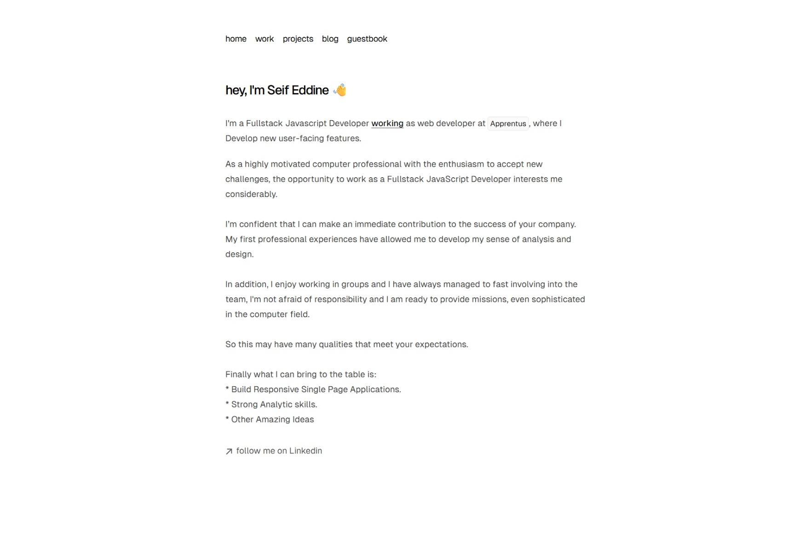
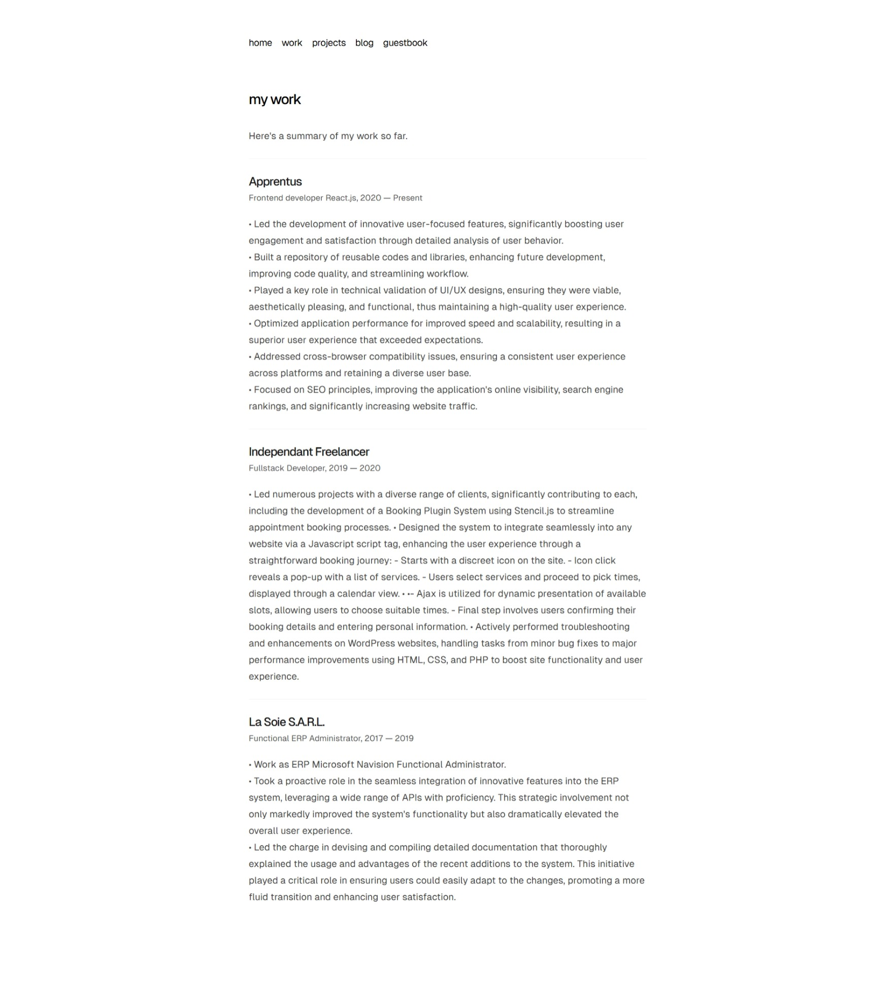
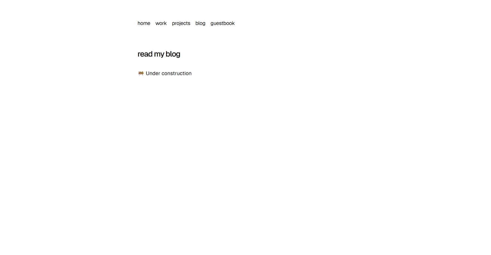
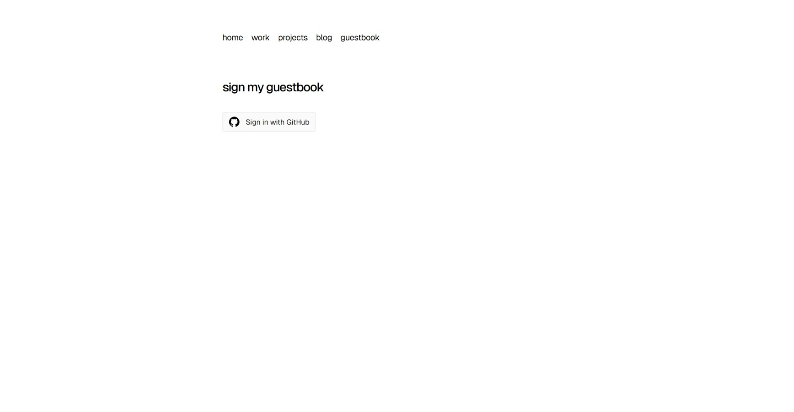
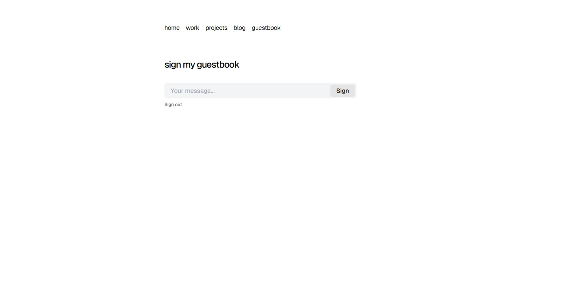

[](https://vercel.com/new/clone?repository-url=https%3A%2F%2Fgithub.com%2FSeifESlimene%2Fmyporfolio.io)

# myporfolio.io

- **Framework**: [Next.js](https://nextjs.org/)
- **Database**: [Postgres](https://vercel.com/postgres)
- **Authentication**: [NextAuth.js](https://next-auth.js.org)
- **Deployment**: [Vercel](https://vercel.com)
- **Styling**: [Tailwind CSS](https://tailwindcss.com)
- **Analytics**: [Vercel Analytics](https://vercel.com/analytics)

## Running Locally

This application requires Node.js v18.17+.

```bash
git clone https://github.com/SeifESlimene/myporfolio.io.git
cd myporfolio.io
bun install
bun run setup # Remove all of my personal information
bun dev
```

Create a `.env.local` file similar to [`.env.example`](https://github.com/SeifESlimene/myporfolio.io/blob/main/.env.example).

## Database Schema

```sql
CREATE TABLE redirects (
  id SERIAL PRIMARY KEY,
  source VARCHAR(255) NOT NULL,
  destination VARCHAR(255) NOT NULL,
  permanent BOOLEAN NOT NULL
);

CREATE TABLE guestbook (
  id SERIAL PRIMARY KEY,
  email VARCHAR(255) NOT NULL,
  body TEXT NOT NULL,
  created_by VARCHAR(255) NOT NULL,
  created_at TIMESTAMP NOT NULL,
  updated_at TIMESTAMP
);

CREATE TABLE views (
  slug VARCHAR(255) PRIMARY KEY,
  count INT NOT NULL
);
```

## Screenshots








## License

1. You are free to use this code as inspiration.
2. Please do not copy it directly.
3. Crediting the author is appreciated.

Please remove all of my personal information (blog posts, images, etc.) by running `bun run setup`.
